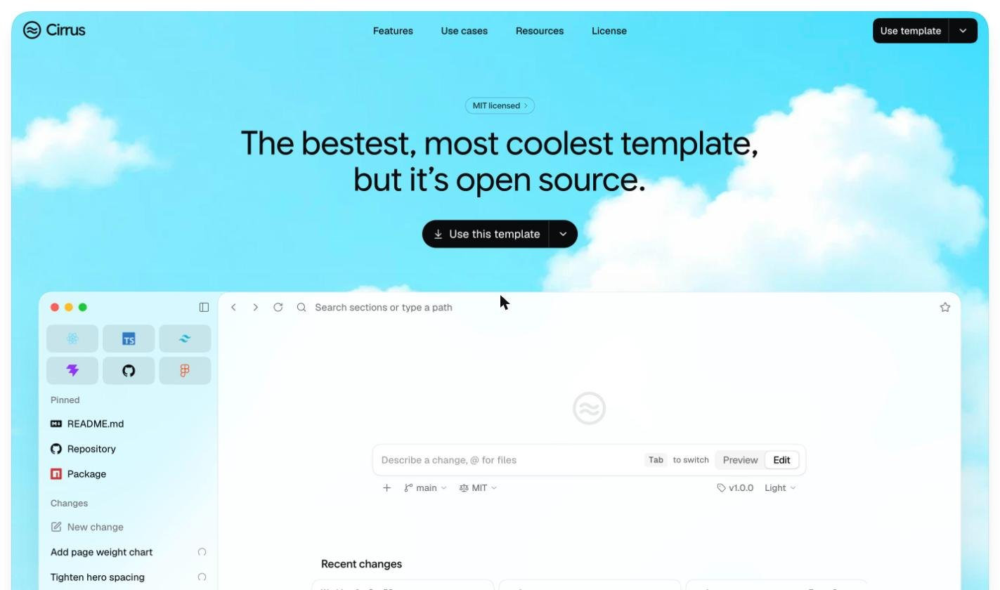

# Cirrus

A landing page template for open source projects. Plain React and CSS, MIT licensed, no trackers.

[](https://github.com/theomirzakhanian/cirrus/actions/workflows/ci.yml)
[](LICENSE)

[Live demo](https://cirrus-beige.vercel.app) · [Use this template](https://github.com/theomirzakhanian/cirrus/generate) · [Deploy to Vercel](https://vercel.com/new/clone?repository-url=https%3A%2F%2Fgithub.com%2Ftheomirzakhanian%2Fcirrus)



Plenty of open source projects have a good README and a bad homepage, or no homepage at all. Cirrus is the page I wanted to start from. It has a hero with a product window, a wall of app icons, feature cards, a chart, a closing call to action and a footer, and you can restyle all of it in an afternoon.

Everything on the page is real code in this repo. The chart shows what the page actually weighs, measured from the build. The menus work. Every link lives in one typed file, so a missing one fails the build instead of shipping a dead button. The whole page is about 250 kB gzipped.

## Get started

Click "Use this template" at the top of the repo, or clone it:

```bash
git clone https://github.com/theomirzakhanian/cirrus my-project
cd my-project
npm install
npm run dev
```

You need Node 22 or newer. `npm run build` writes static files to `dist`.

## Make it yours

Three files do most of the work.

`src/site.ts` holds the name, the repo URL, the license, and every menu and footer link. Change `repo` first. The "Use template" button, Source, Issues and the rest are built from it.

`src/index.css` holds the design tokens: colors, fonts and easing, all in the `@theme` block at the top. A rebrand starts there.

`src/App.tsx` is the page, top to bottom. Delete a line to drop a section. Move a line to reorder them.

Two things are stand-ins you'll want to replace. The window in the hero is drawn in markup, so swap it for a screenshot of your own project. And `public/sky.webp` is the hero background, so drop in your own image of any size and update the width and height on the `` in `src/components/hero.tsx`.

## What's on the page

Each section is one component with no shared state, so you can remove any of them without breaking the rest.

| Component | File |
| --- | --- |
| Hero, with the product window | `src/components/hero.tsx` |
| Intro, app wall, pitch, use cases, page weight chart, reorder | `src/components/features.tsx` |
| Theming, site.ts | `src/components/theming.tsx` |
| Open source tiles | `src/components/open.tsx` |
| Closing banner, footer | `src/components/end.tsx` |
| Top bars, menus, the split button | `src/components/nav.tsx` |

The app wall is generated from a list in `scripts/apps.mjs`. Change the list, run `node scripts/apps.mjs`, and it rewrites `src/apps.ts`.

## Deploy

It's a folder of static files, so anywhere that serves a folder works. Set the build command to `npm run build` and the output directory to `dist`. The Vercel button above does that for you.

If you host under a sub-path, like GitHub Pages at `username.github.io/repo`, set `base` in `vite.config.ts` to match.

## Page weight

The chart is not a mock-up. `npm run weigh` builds the site, measures every file in `dist` as plain, gzip and brotli, and writes the numbers to `src/weights.ts`. Run it again after you change the page, then build.

## Good to know

Corners use `corner-shape: superellipse()`, which gives the smooth, app-icon curve in Chrome and other Chromium browsers. Everywhere else they fall back to ordinary round corners.

Every animation stops under `prefers-reduced-motion`. Buttons, links, tabs and menu items use the pointer cursor.

Text colors were checked against white. AA needs 4.5 for body text.

| Token | Color | Ratio | Body text |
| --- | --- | --- | --- |
| `--color-ink` | `#090b0c` | 19.72 | Passes |
| `--color-muted` | `#737373` | 4.74 | Passes |
| `--color-link` | `#0077bc` | 4.81 | Passes |
| `--color-faint` | `#a1a1a1` | 2.58 | Fails. Only used inside the drawn pictures. |
| `--color-fill` | `#f5f5f5` | 1.09 | Fails. A background, never text. |

Cirrus has no dark mode, router, CMS or analytics. The hero demo shows a running timer and a few small loops but doesn't play a scripted story. I'd rather you add those yourself than carry code you don't use.

## Credits

The layout follows the aside.com landing page. No code or assets from that site are used here.

The headline font is Google Sans Flex, set to optical size 100 and cut down to the weight axis (`src/fonts/google-sans-flex-display.woff2`, licence in `src/fonts/OFL.txt`). I picked it by scoring 136 open fonts on letter shape, weight and spacing against the font on aside.com. Body text is Geist. Both are under the SIL Open Font License, and Fontsource packages them.

Icons come from Lucide (ISC), Simple Icons (CC0) and SVG Logos (CC0). The app logos on the wall belong to their owners and are there only to name the apps.

The sky in the hero is an AI-generated image, so replace it if you'd rather have your own. `scripts/sky.py` draws a rough procedural sky if you want a starting point: `python3 scripts/sky.py public/sky.webp preview.png`, with numpy and Pillow installed.

## Contributing

Issues and pull requests are welcome. [CONTRIBUTING.md](CONTRIBUTING.md) covers what fits, and the [code of conduct](CODE_OF_CONDUCT.md) is short.

## License

MIT. See [LICENSE](LICENSE).
